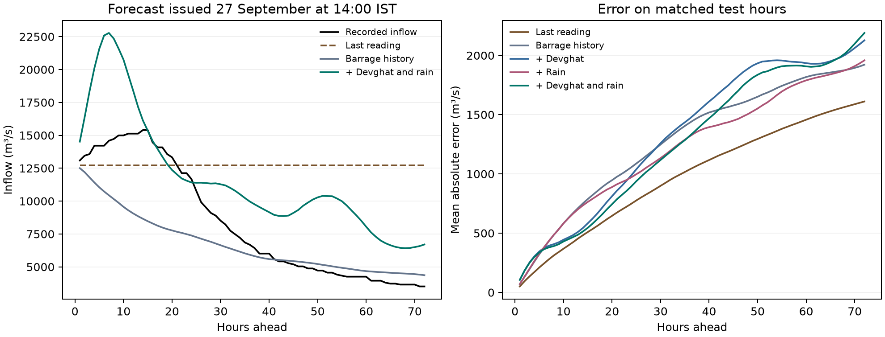

# When does a river forecast change a decision?
## Flood warning at Gandak Barrage and water allocation on the Potomac

### Abstract

Could a river forecast change a decision in time? We replayed two decisions using historical inputs and checked the outcomes afterwards. On the Gandak River, a model using barrage inflow, upstream water levels and forecast rain signalled six hours before the barrage crossed a study-defined high-flow threshold in September 2026. By then the downstream gauge at Khadda had already reached its official warning level one hour earlier. The signal preceded the higher danger level by 47 hours. Village loudspeaker warnings were documented, but their first receipt time is unknown. Only one hourly flood episode could be tested. On the Potomac, we forecast next-day water use from the calendar and compared it with reconstructed municipal withdrawals on 2,041 days. Mean absolute demand error was 106,378 m³/day, 34% lower than using the historical average. With that demand forecast, planning against a conservative river-flow estimate cut overcommitment from 36.6% to 1.0% of days compared with the ensemble mean, while leaving an extra 98,699 m³/day of demand unmet. The replays show how the location of a gauge and the amount a planner is willing to promise change the practical value of a forecast.

### Research question and related work

Kratzert et al. [1] evaluated LSTM rainfall–runoff models across 241 catchments. Raftery et al. [2] calibrated weather forecast ensembles. Their methods motivate the Potomac benchmark, where the question is how forecast uncertainty changes a daily allocation. Delaney et al. [3] already evaluated ensemble forecasts for reservoir operations. Our narrower addition is a break-even cost for an explicit allocation rule, together with an audit of uncertainty in different flow conditions.

Earlier work also used rainfall to forecast Narayani floods at Devghat [4]. Kumar et al. [5] studied daily water levels at Triveni at one-, five- and ten-day leads. We ask a different question at the downstream barrage: how much warning does an upstream reading add once its reporting delay is respected, and does earlier warning improve the predicted magnitude of the crest? Two independent cases address different decisions. We estimate no transfer of a fitted model between basins.

---

### Gandak experiment

The target is hourly barrage inflow in the Central Water Commission archive [6]. We retained the existing August–October 2026 study window and data cleaning. All training targets precede 16 September. We joined the last 25 hours of local flow history to 10,466 dated Devghat records from Nepal’s BIPAD archive [7]. At each issue time, the latest eligible gauge measurement had to be at most two hours old, and both its creation and last modification in the archive had to precede or equal issue time. Features were level and six-hour change. The latest gauge level at the crest forecast was 11.80 m, compared with a maximum of 7.39 m in the pre-test period under the same availability rule.

For rainfall we retrieved individual 00 UTC NOAA GFS runs through Open-Meteo [8]. We averaged forecasts at three upstream grid points near Pokhara, Besisahar and Gorkha. The predictors summed forecast precipitation over the preceding six hourly endpoints and the next forecast horizon. Each issue used a single archived run at least 12 hours old. A 24-hour minimum age tested sensitivity to later delivery. These sites sample part of the basin. Actual GFS file delivery times and historical revisions to the barrage series are unknown.

We fitted a separate regression at each lead from 1 to 72 hours. Each used the original ridge penalty and training-only scaling. The comparisons used identical complete training and test rows for the local, gauge-added, rain-added and combined regressions. Persistence carries the current inflow forward. At 24 hours we could evaluate 809 of 975 otherwise eligible test issues. Missing or stale inputs account for the excluded cases. The results describe the hours on which the extended model could run.

### Did the extra inputs give earlier warning?

We defined high flow as the 95th percentile of training inflow, 5,022 m³/s. This is a research threshold. An onset required 24 preceding hours below it. From each eligible hour below the threshold, a warning meant the model predicted at least one crossing in the next 24 hours. At 22:00 IST on 25 September the observed inflow crossed the threshold. The combined model first warned at 16:00, the gauge model at 18:00. Rain alone and local history alone gave no advance warning. The combined model issued six positive hourly decisions, all for this one event, across 739 eligible decisions. This sample gives little information about the long-run false-alarm rate.

Using a 24-hour rainfall release lag reduced the combined warning to five hours. Using the training 90th or 99th percentile as the event threshold gave five and six hours respectively under the primary release assumption. All three thresholds describe the same flood episode.

---

### Did earlier warning improve the crest forecast?

Figure 1. The left panel follows one forecast issued at 14:00 IST on 27 September. The right panel compares all models at each lead on matched observations. Gauge and rain additions include the local barrage history.

The observed maximum was 15,396 m³/s at hour 14. The local regression predicted a maximum of 12,505 m³/s. Adding the gauge and rain instead produced 22,780 m³/s at hour 7, an overshoot of 7,384 m³/s. The event extended beyond the upstream levels seen in training. Extrapolation is a plausible explanation for the overshoot. A single event cannot isolate its cause.

| 24-hour model | Mean absolute error (m³/s) | Root-mean-square error (m³/s) |
| --- | ---: | ---: |
| Last reading | 749 | 1,671 |
| Barrage history | 1,057 | 1,861 |
| Barrage and Devghat | 989 | 1,641 |
| Barrage and rain | 972 | 1,790 |
| Barrage, Devghat and rain | 896 | 1,534 |

The combined model reduced errors relative to the local regression at 24 hours. Relative to the last reading it made larger absolute errors on average, but scored better on the measure that gives large errors more weight. A paired three-day block bootstrap estimated a combined-minus-local mean absolute error difference of −161 m³/s (95% interval −329 to −59). Against the last reading the difference was +147 m³/s (−154 to +352). These descriptive intervals use 2,000 circular resamples of calendar days and only 37 matched test dates. The September episode was known during study design.

---

### When should a flood forecaster be cautious?

At issue time we flagged Devghat levels below 3.943 m or above 7.389 m, the limits in the combined model’s training rows. For each complete 72-hour forecast, we compared its predicted maximum with the observed maximum over the same hours. Each forecast contributed one absolute peak error, even if the two peaks occurred at different hours. The September crest forecast was flagged high. The overlapping windows often cover the same flood.

| Upstream gauge at issue | Complete forecasts | Mean absolute peak error (m³/s) |
| --- | ---: | ---: |
| Below training range | 354 | 2,259 |
| Within training range | 406 | 1,673 |
| Above training range | 49 | 4,715 |

Of the 81 forecasts with the largest peak errors, 19 were flagged high, 28 low and 34 fell inside the training range. A high flag identified 19 large errors in 49 forecasts. It signals when a crest estimate deserves closer inspection. Its long-run reliability still needs testing across other floods.

### What could earlier monsoons actually test?

We saved the 72 fitted regressions, their scaling constants and the warning threshold. The CWC archive [6] contained 43, 152 and 153 inflow readings in June–October of 2023, 2024 and 2025 respectively, all at 08:00 IST. None of those seasons supplied the 25 consecutive hours needed to issue even one forecast with the frozen model. Bihar’s historical bulletins report downstream discharge [10]. Gate operations can change that quantity. The six-hour warning result therefore remains a single-season finding.

A separate test used the morning readings at their recorded frequency. A ridge regression learned to predict next-morning inflow from the current reading and its one-day change, using 148 training pairs in 2024. We fixed the threshold at the 2024 morning inflow’s 95th percentile (5,516 m³/s). In 2025, 145 forecasts could be scored. There were 144 issues below the threshold. On 16 September the model forecast 4,108 m³/s for the next morning, when 6,082 m³/s was observed. Both the daily model and persistence missed this sole assessable crossing and gave zero false warnings. Their mean absolute errors were 354 and 353 m³/s respectively. These data can detect crossings between morning readings only when the flow remains high at the second reading.

---

### Potomac allocation and forecast uncertainty

For USGS gauge 01646500 at Little Falls [9], four neural networks used 30 days of flow history to forecast the next day. Training used 1990–2009, model selection 2010–2014, ensemble calibration 2015–2019, and testing 2020–2025. Across 2,192 test days the stacked LSTM achieved a root-mean-square error of 111.2 m³/s, compared with 145.8 for persistence. The calibrated ensemble supplied a range as well as a mean.

We checked whether the nominal 90% forecast interval covered observed flows under different conditions. We defined the bands from calibration-period flow and assigned each forecast using the previous day’s reading, which the model already knew. Coverage was 94.4% after low flows (339 days), 92.9% in the middle band (1,782 days), and 88.7% after high flows (71 days). The high-flow sample is small. The pooled 93.0% coverage conceals this difference.

The allocation replay assumes total demand of 3 million m³/day, a 20 m³/s environmental reserve and a diversion limit of 10% of flow above that reserve. Planning with the ensemble fifth percentile instead of its mean avoided 75,809 m³ of excess commitments per day but left another 269,332 m³ of demand unmet. If each type of loss carries a constant unit cost, the break-even ratio is 269,332 / 75,809 = 3.55. The conservative rule minimizes cost between these two policies only above this ratio. Annual break-even ratios ranged from 3.04 to 4.09. These values describe the specified scenario. Regional operating costs are unknown.

---

### What changed with recorded Potomac water use?

USGS defines adjusted flow at Little Falls as measured river flow plus upstream diversions reported by cooperating agencies [11]. We subtracted the two published daily flows and converted cubic feet per second to m³/day. Of 2,192 test dates, 2,041 had a positive difference and approved values for both series. We excluded four missing pairs, 145 pairs with provisional or estimated values, and two zero differences. Published flows are rounded, so the differences approximate fulfilled withdrawals. They cannot reveal requests that suppliers had to turn down.

We used each day’s reconstructed volume as the simulated request and kept the original forecasts, reserve and diversion cap. The daily amounts averaged 1.31 million m³. Across matched days the conservative rule reduced overcommitment from 35.7% to 0.9%. It avoided 25,091 m³/day of excess commitments while leaving another 100,674 m³/day unmet. The resulting break-even cost ratio was 4.01. Holding demand constant at the same mean gave 4.25. Using the original 3 million m³/day on those same dates gave 3.61.

| Season | Matched days | Break-even cost ratio |
| --- | ---: | ---: |
| Winter (Dec–Feb) | 477 | 6.18 |
| Spring (Mar–May) | 541 | 5.87 |
| Summer (Jun–Aug) | 540 | 3.57 |
| Autumn (Sep–Nov) | 483 | 3.48 |

For example, if an excess commitment cost four times as much per unit as an unmet request, conservative planning would have cost less in summer and autumn. The original flow forecasts describe water remaining at the downstream gauge after actual diversions. Here they supply a common reference for comparing policies. The replay uses withdrawals known after the fact, assumes they were requested in full at decision time, and measures simulated outcomes. The following replay estimates demand in advance. A utility trial would also need actual requests, operating costs and pre-withdrawal flows.

---

### Replaying the two decisions with the outcomes hidden

For the Gandak we used Khadda, a downstream gauge with published warning and danger levels of 95.0 and 96.0 m [12]. At each issue hour we used the saved model to predict the highest barrage inflow over the next 24 hours. The signal turned on when that forecast reached the existing 5,022 m³/s threshold. The comparison rule used the latest barrage reading against the same threshold. We then looked up the town’s hourly stage [6]. The archive lacks real-time publication timestamps for the barrage readings. Times below are IST and refer to first recorded threshold attainment.

| Khadda in September 2026 | First recorded crossing | When the model signalled |
| --- | ---: | ---: |
| Warning level, 95 m | 25 Sep, 15:00 | 1 hour after |
| Danger level, 96 m | 27 Sep, 15:00 | 47 hours before |

The first model signal was at 16:00 on 25 September. Waiting for the barrage reading itself gave a signal at 22:00, seven hours after Khadda’s warning level and 41 hours before its danger level. The 47-hour interval is elapsed time between the model signal and the observed crossing. The model forecast barrage inflow only. As a test of next-day town warnings, both rules missed the one 95 m onset and both signalled within the 24 hours before the one 96 m onset. Of 51 positive model decision hours below 96 m, 29 had no danger crossing in the next 24 hours. Repeated decisions can belong to one episode.

What did residents hear? A report published at 15:18 on 25 September described a departmental high alert already in effect [13]. A local report updated at 14:51 on 26 September documented loudspeaker warnings in Khadda-area villages, 24 hours and 9 minutes before the gauge first recorded danger level [14]. Neither identifies when the first resident received a warning. No public alert was issued by this research model.

### How much water would we have promised tomorrow?

For each day in 2020–2025 we forecast withdrawals using only the target date’s position in the year and its weekday. The model was fitted once to 3,519 eligible days from 2010 through October 2019. We left a two-month buffer for monthly reporting and used the training-period mean as a constant-demand baseline. The experiment uses the archived previous day’s flow as available when planning. Historical publication and revision times for individual flow readings are unknown. Both demand rules produced 2,192 forecasts, with 2,041 eligible withdrawals for verification. Mean absolute error fell from 161,038 to 106,378 m³/day. The calendar forecast overestimated use by 38,185 m³/day on average.

---

### What did forecasting demand change?

Each policy promised the smaller of predicted demand and its forecast supply budget. Only after fixing the promise did we reveal observed flow and withdrawals. Delivery was limited by the promise, actual supply and actual use. The following comparison holds the demand forecast fixed across all three ways to estimate tomorrow’s flow.

| Supply estimate | Days overcommitted | Mean unmet use (m³/day) |
| --- | ---: | ---: |
| Previous day’s flow | 32.5% | 412,318 |
| Ensemble mean | 36.6% | 408,333 |
| Ensemble fifth percentile | 1.0% | 507,033 |

Compared with the ensemble mean, the conservative rule avoided 26,063 m³/day of excess commitments while leaving an extra 98,699 m³/day unmet. The break-even unit-cost ratio was 3.79 with forecast demand, compared with 4.01 when the replay was given realized withdrawals in advance. The previous-day flow rule also overcommitted less often than the mean ensemble, at the cost of slightly higher unmet use. All three use the same simulated reserve and diversion cap.

For a dated example, on 10 November 2026 a refit using the available approved archive gave a next-day withdrawal estimate of 1.27 million m³ for 11 November. The latest usable training observation was 29 September 2025. The estimate reflects expected seasonal use. Unusual local conditions can produce larger errors, and the target day was unobserved when this paper was prepared.

### Next field test

A further monsoon with hourly barrage inflow, timestamped upstream readings and archived weather runs would allow the frozen model’s warnings, misses, false alarms and crest errors to be scored together. It would also allow a comparison with an operational forecast for the same target and issue time.

---

### Sources

[1] Kratzert et al. (2018). Rainfall–runoff modelling using LSTM networks. https://doi.org/10.5194/hess-22-6005-2018

[2] Raftery et al. (2005). Using Bayesian model averaging to calibrate forecast ensembles. https://doi.org/10.1175/MWR2906.1

[3] Delaney et al. (2020). Forecast informed reservoir operations using ensemble streamflow predictions. https://doi.org/10.1029/2019WR026604

[4] Artan et al. (2011). Bias-adjusted satellite-based rainfall estimates for predicting floods in the Narayani Basin. https://doi.org/10.1111/j.1753-318X.2011.01121.x

[5] Kumar et al. (2025). Multi-lead-time water-level forecasting in the Gandak River Basin. https://harbinengineeringjournal.com/index.php/journal/article/view/4857

[6] Central Water Commission readings, public historical archive. https://github.com/diagram-chasing/cwc-flood-forecasts

[7] Nepal DHM, Narayani at Devghat, BIPAD observation archive, station 25, series 4140. https://bipadportal.gov.np/api/v1/river/?station=25

[8] NOAA GFS via Open-Meteo, individual forecast runs. https://open-meteo.com/en/docs/single-runs-api

[9] USGS, Potomac River near Washington, DC, station 01646500. https://waterdata.usgs.gov/monitoring-location/USGS-01646500/

[10] Bihar Water Resources Department, historical barrage reports. https://www.fmiscwrdbihar.gov.in/fmis/gate.aspx

[11] USGS, Chesapeake Bay estimated streamflow methods and Potomac diversion adjustment. https://www.usgs.gov/centers/chesapeake-bay-activities/science/chesapeake-bay-estimated-streamflow-methods

[12] Bihar Water Resources Department. Gandak gauge forecast bulletin, 2 June 2026. https://www.fmiscwrdbihar.gov.in/bulletin/Gandak_Model_Result.pdf

[13] Dainik Jagran, Kushinagar, 25 September 2026. Departmental alert for the Gandak. https://www.jagran.com/uttar-pradesh/kushinagar-kushinagar-on-high-alert-gandak-river-flood-threat-from-nepal-rains-40384752.html

[14] Amar Ujala, Kushinagar, 26 September 2026. Loudspeaker warnings in Khadda-area villages. https://www.amarujala.com/uttar-pradesh/kushinagar/narayani-river-surging-alert-issued-for-embankments-flood-threat-to-a-dozen-villages-in-khadda-2026-09-26
